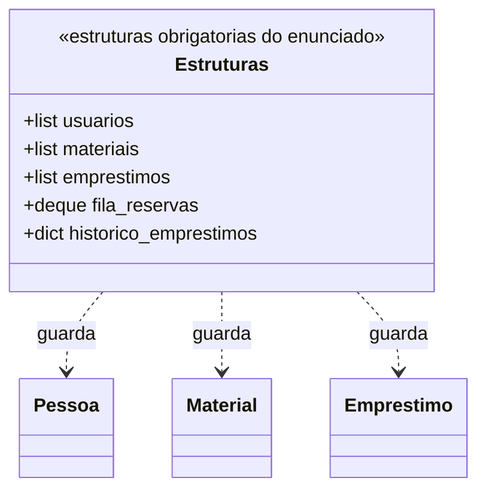

# Parte 1 — Diagrama UML de Classes

**Sistema Inteligente de Biblioteca Digital Comunitária**
Projeto Integrador A3 — Programação Orientada a Objetos (Python 3.12+)

O diagrama abaixo representa as classes, atributos, métodos e
relacionamentos do sistema (herança, associação e interfaces).

```mermaid
classDiagram
    direction TB

    %% ===================== INTERFACES =====================
    class Avaliavel {
        <<interface / classe abstrata>>
        +avaliar(nota int, comentario str)*
        +calcular_media() float*
    }

    %% ===================== PESSOA =====================
    class Pessoa {
        <<abstract>>
        -int __id
        -str __nome
        -str __cpf
        -str __email
        -str __senha_hash
        -dict __consentimento
        -int __contador_id$
        +id int
        +nome str
        +cpf str
        +email str
        +senha_hash str
        +consentimento dict
        +validar_cpf(cpf str) bool$
        +validar_email(email str) bool$
        +validar_data(data str) bool$
        +definir_senha(senha str)
        +aceitar_consentimento(aceito bool)
        +anonimizar_dados()
        +to_dict() dict
        +tipo() str*
        +dados_especificos() dict*
    }

    class Leitor {
        -str __data_nascimento
        -int __limite_emprestimos
        +data_nascimento str
        +limite_emprestimos int
        +tipo() str
        +dados_especificos() dict
    }

    class Bibliotecario {
        -str __matricula
        -str __setor
        +matricula str
        +setor str
        +tipo() str
        +dados_especificos() dict
    }

    %% ===================== MATERIAL =====================
    class Material {
        <<abstract, implements Avaliavel>>
        -int __id
        -str __titulo
        -str __autor
        -int __total_exemplares
        -int __exemplares_disponiveis
        -int __exemplares_reservados
        -int __total_emprestimos
        -list __avaliacoes
        -int __contador_id$
        +id int
        +titulo str
        +autor str
        +total_exemplares int
        +exemplares_disponiveis int
        +exemplares_reservados int
        +total_emprestimos int
        +adicionar_disponivel(q int)
        +remover_disponivel(q int)
        +segregar_para_reserva()
        +atender_reserva()
        +registrar_emprestimo()
        +avaliar(nota int, comentario str)
        +calcular_media() float
        +total_avaliacoes int
        +to_dict() dict
        +calcular_multa(dias_atraso int) float*
        +tipo() str*
        +dados_especificos() dict*
    }

    class LivroFisico {
        -str __isbn
        +isbn str
        +calcular_multa(dias int) float
        +tipo() str
        +dados_especificos() dict
    }

    class LivroDigital {
        -str __isbn
        -float __tamanho_mb
        -str __formato
        +isbn str
        +tamanho_mb float
        +formato str
        +calcular_multa(dias int) float
        +tipo() str
        +dados_especificos() dict
    }

    class Revista {
        -str __issn
        -str __edicao
        +issn str
        +edicao str
        +calcular_multa(dias int) float
        +tipo() str
        +dados_especificos() dict
    }

    %% ===================== EMPRESTIMO =====================
    class Emprestimo {
        -int __id
        -int __id_usuario
        -str __cpf_usuario
        -int __id_material
        -str __data_emprestimo
        -str __data_prevista
        -str __data_devolucao
        -float __multa
        +id int
        +ativo bool
        +data_emprestimo str
        +data_prevista str
        +data_devolucao str
        +multa float
        +dias_atraso(data str) int
        +registrar_devolucao(multa float) str
        +to_dict() dict
        +from_dict(dados dict) Emprestimo$
    }

    %% ===================== EXCECOES =====================
    class MaterialIndisponivelError
    class LimiteEmprestimosError
    class AvaliacaoInvalidaError
    class UsuarioNaoEncontradoError
    class MaterialNaoEncontradoError
    class EntradaInvalidaError
    class ReservaJaRealizadaError
    class EmprestimoNaoEncontradoError

    %% ===================== RELACIONAMENTOS =====================
    Pessoa <|-- Leitor : heranca
    Pessoa <|-- Bibliotecario : heranca
    Material <|-- LivroFisico : heranca
    Material <|-- LivroDigital : heranca
    Material <|-- Revista : heranca
    Avaliavel <|.. Material : implementa (interface)

    Pessoa "1" --> "0..*" Emprestimo : realiza
    Material "1" --> "0..*" Emprestimo : e emprestado em

    Exception <|-- MaterialIndisponivelError
    Exception <|-- LimiteEmprestimosError
    Exception <|-- AvaliacaoInvalidaError
    Exception <|-- UsuarioNaoEncontradoError
    Exception <|-- MaterialNaoEncontradoError
    Exception <|-- EntradaInvalidaError
    Exception <|-- ReservaJaRealizadaError
    Exception <|-- EmprestimoNaoEncontradoError
```

## Legenda dos relacionamentos

| Símbolo | Significado | Ocorrência no sistema |
|---|---|---|
| `<\|--` | Herança (generalização) | `Pessoa → Leitor/Bibliotecario`; `Material → LivroFisico/LivroDigital/Revista` |
| `<\|..` | Realização de interface | `Material` implementa a interface `Avaliavel` (`avaliar`, `calcular_media`) |
| `-->` | Associação | Um `Pessoa` realiza 0..* `Emprestimo`; um `Material` participa de 0..* `Emprestimo` |
| `*` no método | Método abstrato | `calcular_multa()`, `tipo()`, `dados_especificos()` |
| Atributos `-` / métodos `+` | Privados / públicos | Todos os atributos são privados (`__atributo`) com `@property` |

## Estruturas de dados representadas (fora das classes)

- **List** → `usuarios`, `materiais`, `emprestimos`, `avaliacoes`
- **Queue (`deque`)** → `fila_reservas`: fila de espera de reservas com ordem estrita de chegada (persistida em `dados/fila_reservas.json`)
- **Dictionary** → `historico_emprestimos[cpf] = [ids de empréstimos]`
