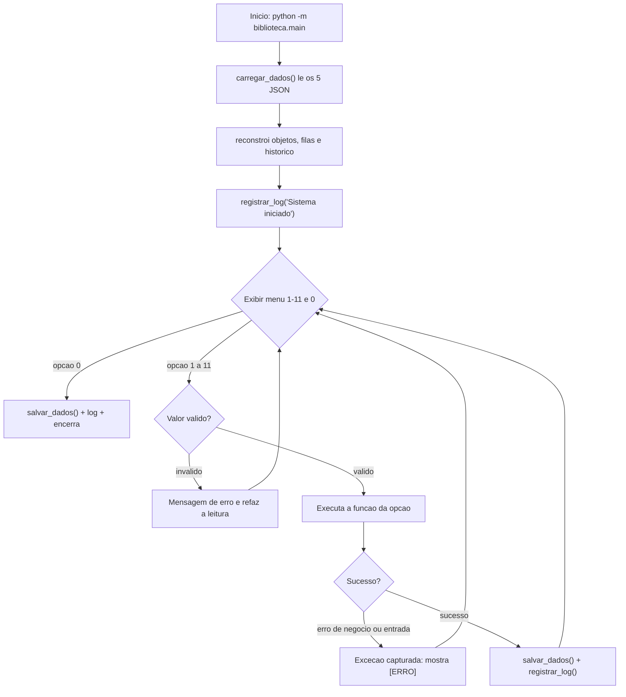
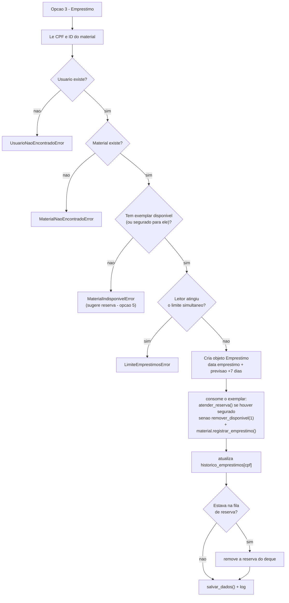
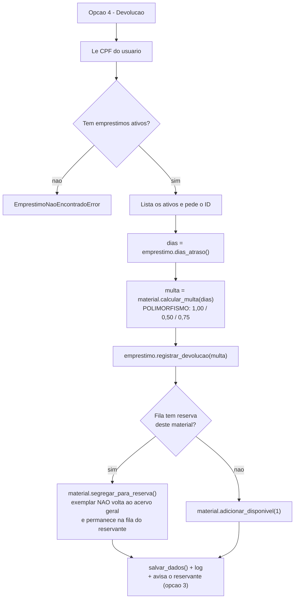
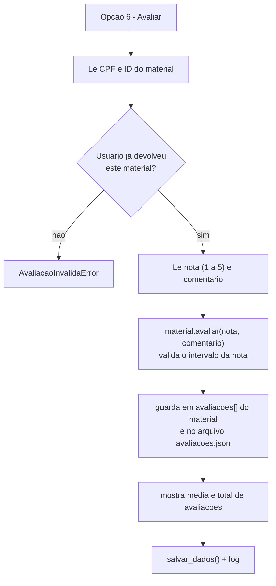
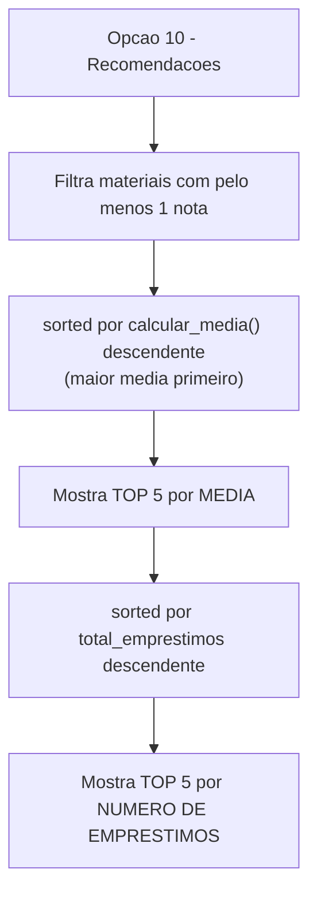
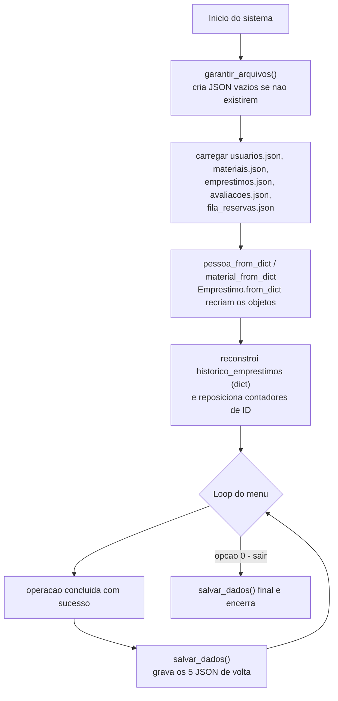

# Parte 3 — Relatório Técnico

**Sistema Inteligente de Biblioteca Digital Comunitária**
Projeto Integrador A3 — Programação Orientada a Objetos
Linguagem: Python 3.12.5

---

## 1. Visão geral

Aplicação de terminal que cadastra usuários (leitores e bibliotecários) e
materiais (livro físico, livro digital e revista), controla empréstimos,
reservas em fila de espera, avaliações e recomendações automáticas —
com persistência em JSON e módulo de Cidadania Digital e LGPD.

### Como executar

```bash
# a partir da pasta do projeto (raiz)
python -m biblioteca.main
```

### Estrutura do projeto

```
biblioteca/
├── main.py                       ponto de entrada
├── menu.py                       menu (opções 1–11 e 0) + regras RF01–RF06
├── modelos/
│   ├── pessoa.py                 Pessoa (ABC)
│   ├── leitor.py                 Leitor(Pessoa)
│   ├── bibliotecario.py          Bibliotecario(Pessoa)
│   ├── avaliavel.py              interface Avaliavel (ABC)
│   ├── material.py               Material(Avaliavel, ABC)
│   ├── livro_fisico.py           LivroFisico(Material)
│   ├── livro_digital.py          LivroDigital(Material)
│   ├── revista.py                Revista(Material)
│   └── emprestimo.py             Emprestimo
├── excecoes/
│   └── erros.py                  8 exceções personalizadas
├── persistencia/
│   └── json_manager.py           leitura/gravação dos JSON
├── lgpd/
│   └── cidadania_digital.py      desafio extra (+20%)
└── dados/
    ├── usuarios.json
    ├── materiais.json
    ├── emprestimos.json
    ├── avaliacoes.json
    ├── fila_reservas.json
    └── logs.json

docs/
├── diagrama_uml.md               Parte 1 (Mermaid)
└── relatorio_tecnico.md          Parte 3 (este arquivo)
```

---

## 2. Classes criadas

### 2.1 Pacote `modelos/`

| Arquivo | Classe | Tipo | Responsabilidade |
|---|---|---|---|
| `pessoa.py` | `Pessoa` | **Abstrata (ABC)** | Dados comuns (ID, nome, CPF, e-mail), validações, senha hash e consentimento LGPD |
| `leitor.py` | `Leitor` | Concreta | Herda de `Pessoa`; data de nascimento e limite de empréstimos |
| `bibliotecario.py` | `Bibliotecario` | Concreta | Herda de `Pessoa`; matrícula funcional e setor |
| `avaliavel.py` | `Avaliavel` | **Interface (ABC)** | `avaliar(nota, comentario)` e `calcular_media()` |
| `material.py` | `Material` | **Abstrata (ABC)** | Implementa `Avaliavel`; declara `calcular_multa()` abstrato; controla exemplares, empréstimos e avaliações |
| `livro_fisico.py` | `LivroFisico` | Concreta | Multa R$ 1,00/dia; ISBN |
| `livro_digital.py` | `LivroDigital` | Concreta | Multa R$ 0,50/dia; tamanho (MB) e formato |
| `revista.py` | `Revista` | Concreta | Multa R$ 0,75/dia; ISSN e edição |
| `emprestimo.py` | `Emprestimo` | Concreta | Datas de empréstimo/prevista/devolução, atraso e multa |

### 2.2 Demais pacotes

| Pacote | Arquivo | Responsabilidade |
|---|---|---|
| `excecoes/` | `erros.py` | Exceções personalizadas |
| `persistencia/` | `json_manager.py` | Criação, leitura e gravação dos JSON |
| `lgpd/` | `cidadania_digital.py` | Consentimento, anonimização, logs, SHA-256, relatório de uso |
| raiz | `menu.py` | Interface de terminal e regras de negócio |
| raiz | `main.py` | Ponto de entrada |

---

## 3. Fluxogramas

### 3.1 Fluxograma geral (inicialização e menu)



### 3.2 Empréstimo (RF03)



### 3.3 Reserva (RF04)

```mermaid
flowchart TD
    A["Opcao 5 - Reservar"] --> B["Le CPF e ID do material"]
    B --> C{"Ha exemplares disponiveis?"}
    C -->|sim| D["EntradaInvalidaError<br/>use a opcao 3"]
    C -->|nao| E{"Usuario ja esta<br/>na fila deste material?"}
    E -->|sim| F["ReservaJaRealizadaError"]
    E -->|nao| G["fila_reservas.append((cpf, id))<br/>ordem de chegada preservada]
    G --> H["mostra a posicao na fila"]
    H --> I["salvar_dados() (grava fila_reservas.json) + log"]
```

### 3.4 Devolução + multa polimórfica + atendimento da fila



### 3.5 Avaliação (RF05)



### 3.6 Recomendações (RF06)



### 3.7 Persistência (leitura e gravação)



---

## 4. Conceitos de POO aplicados

### 4.1 Encapsulamento

Todos os atributos de todas as classes são **privados** (`self.__atributo` —
*name mangling* do Python) e só são acessados por `@property` e `@setter`,
que **validam** o valor antes de gravar e lançam exceção quando o dado é
inválido:

```python
@property
def nome(self) -> str:
    return self.__nome

@nome.setter
def nome(self, valor: str):
    if not isinstance(valor, str) or not valor.strip():
        raise EntradaInvalidaError("O nome deve ser preenchido corretamente!")
    self.__nome = valor.strip()
```

Validações feitas nos *setters*: CPF com dígitos verificadores, formato de
e-mail, data `dd/mm/aaaa`, nota de 1 a 5, ISBN com 10/13 caracteres, ISSN
com 8 caracteres, tamanho de arquivo > 0, limite de empréstimos > 0.

> Detalhe: o atributo é privado, mas a classe que o declara continua podendo
> acessá-lo — por isso `Pessoa.anonimizar_dados()` grava diretamente em
> `self.__nome` (os setters rejeitariam os valores mascarados da LGPD).

### 4.2 Herança

```
Pessoa (ABC)                     Material (Avaliavel, ABC)
 ├── Leitor                       ├── LivroFisico
 └── Bibliotecario                ├── LivroDigital
                                  └── Revista
```

```python
class Leitor(Pessoa):
    def __init__(self, nome, cpf, email, data_nascimento,
                 limite_emprestimos=3, id_pessoa=None):
        super().__init__(nome, cpf, email, id_pessoa)   # reutiliza o que é comum
        ...
```

- `super().__init__()` reaproveita atributos e validações da superclasse.
- Cada subclasse implementa os métodos abstratos (`tipo()`,
  `dados_especificos()`) e adiciona apenas o que é próprio dela.

### 4.3 Polimorfismo

`calcular_multa(dias_atraso)` é declarado **abstrato** em `Material` e
implementado com regra própria em cada subclasse:

| Classe | Regra | `material.calcular_multa(5)` |
|---|---|---|
| `LivroFisico` | R$ 1,00 por dia | `5.00` |
| `LivroDigital` | R$ 0,50 por dia | `2.50` |
| `Revista` | R$ 0,75 por dia | `3.75` |

Na devolução o menu chama **sem saber o tipo concreto**:

```python
multa = material.calcular_multa(dias)   # cada classe aplica a sua regra
```

Também são polimórficos `tipo()`, `dados_especificos()`, `avaliar()` e
`calcular_media()`.

### 4.4 Abstração e interfaces

```python
class Avaliavel(ABC):                       # interface
    @abstractmethod
    def avaliar(self, nota, comentario): ...
    @abstractmethod
    def calcular_media(self): ...

class Material(Avaliavel, ABC):             # classe abstrata
    @abstractmethod
    def calcular_multa(self, dias_atraso): ...

class Pessoa(ABC):                          # classe abstrata
    @abstractmethod
    def tipo(self): ...
    @abstractmethod
    def dados_especificos(self): ...
```

- `Material` e `Pessoa` **não podem ser instanciadas** — só as subclasses
  concretas.
- `Material` implementa a *interface* `Avaliavel` (realização, representada
  no UML com `..|>`).
- Nota técnica: a ordem das classes base importa. `class Material(ABC,
  Avaliavel)` gera erro de MRO (*Cannot create a consistent method
  resolution order*) porque `Avaliavel` já herda de `ABC`; por isso a
  declaração correta é `class Material(Avaliavel, ABC)`.

---

## 5. Estruturas de dados

Declaradas em `menu.py`, exatamente como pede o enunciado:

```python
usuarios = []                       # List  -> usuarios cadastrados (RF01)
materiais = []                      # List  -> materiais cadastrados (RF02)
emprestimos = []                    # List  -> emprestimos (RF03)
fila_reservas = deque()             # Queue -> fila de espera (RF04)
historico_emprestimos = {}          # Dict  -> cpf_usuario -> [ids]
avaliacoes = []                     # List  -> avaliacoes (RF05)
```

| Estrutura | Onde é usada | Como |
|---|---|---|
| **List** | `usuarios`, `materiais`, `emprestimos` | `append()` para cadastrar, `for` para buscar, compreensão de lista para filtrar |
| **Queue (`deque`)** | `fila_reservas` | `append()` entra no fim, `remove()`/`popleft()` atende o primeiro → fila **FIFO** com ordem de chegada garantida; persistida em `fila_reservas.json` (sobrevive ao reinício) |
| **Dictionary** | `historico_emprestimos` | `historico_emprestimos[cpf] = [ids]` — acesso direto ao histórico do usuário no relatório (opção 9) |

Exemplos de uso de lista e dicionário no código:

```python
# list comprehension: filtrar emprestimos ativos
ativos = [e for e in emprestimos if e.cpf_usuario == cpf and e.ativo]

# dicionario: historico por usuario
historico_emprestimos.setdefault(usuario.cpf, []).append(novo.id)
```

---

## 6. Tratamento de exceções

Exceções personalizadas em `excecoes/erros.py` (todas herdam de `Exception`):

| Exceção | Situação |
|---|---|
| `MaterialIndisponivelError` | Sem exemplares disponíveis no empréstimo |
| `LimiteEmprestimosError` | Leitor atingiu o limite de empréstimos simultâneos |
| `AvaliacaoInvalidaError` | Nota fora de 1–5 ou avaliação antes da devolução |
| `UsuarioNaoEncontradoError` | CPF não cadastrado |
| `MaterialNaoEncontradoError` | ID de material inexistente |
| `EntradaInvalidaError` | Dados inválidos (CPF, e-mail, ISBN, reserva sem necessidade...) |
| `ReservaJaRealizadaError` | Usuário já está na fila do mesmo material |
| `EmprestimoNaoEncontradoError` | Nenhum empréstimo ativo para devolução |

Onde são usadas:

- **`raise`** nos *setters* e nas regras de negócio (origem do erro).
- **`try/except`** no menu, capturando todas as exceções de negócio em um
  único bloco por opção — o programa mostra `[ERRO]` e **continua rodando**:

```python
try:
    acoes[opcao]()
except (EntradaInvalidaError, UsuarioNaoEncontradoError,
        MaterialIndisponivelError, LimiteEmprestimosError,
        AvaliacaoInvalidaError, ...) as erro:
    print(f"\n  [ERRO] {erro}")
```

- **`try/except ValueError`** na leitura de números (`ler_inteiro`), que
  repete a pergunta até o usuário digitar um inteiro válido.
- **`try/except json.JSONDecodeError`** na leitura dos JSON: arquivo vazio
  ou corrompido não derruba o sistema (retorna o valor padrão `[]`).

---

## 7. Persistência em JSON

| Arquivo | Conteúdo |
|---|---|
| `usuarios.json` | lista de Leitores e Bibliotecários |
| `materiais.json` | lista dos 3 tipos de material, incluindo avaliações |
| `emprestimos.json` | datas, multas e situação de cada empréstimo |
| `avaliacoes.json` | registro global de todas as avaliações |
| `fila_reservas.json` | fila de espera de reservas (RF04) — CPF + ID do material, na ordem de chegada |
| `logs.json` | log de auditoria de cada operação (LGPD) |

Fluxo (ver fluxograma 3.7):

1. **Ao iniciar**: `carregar_dados()` lê os arquivos, recria os objetos com
   `pessoa_from_dict()`, `material_from_dict()` e `Emprestimo.from_dict()`,
   reconstrói o dicionário `historico_emprestimos` e reposiciona os
   contadores de ID (evita ID duplicado após reiniciar).
2. **Após cada operação relevante**: `salvar_dados()` grava tudo de volta.
3. Cada modelo possui `to_dict()` para serialização; o diretório e os
   arquivos são criados automaticamente se não existirem.
4. **A fila de reservas também é persistida**: `salvar_todos()` grava
   `fila_reservas.json` e `carregar_dados()` recompõe o `deque` na ordem
   original — a fila de espera (RF04) sobrevive ao reinício do sistema.

---

## 8. Todos os conceitos e recursos da linguagem utilizados

| Conceito | Recurso do Python | Onde é usado |
|---|---|---|
| Classe | `class` | todas as classes de `modelos/` |
| Atributo privado | `self.__atributo` (*name mangling*) | todos os atributos das classes |
| Encapsulamento | `@property` e `@setter` | getters/setters validadores de `Pessoa`, `Material`, etc. |
| Herança | `class Leitor(Pessoa)` | hierarquia `Pessoa` e `Material` |
| Construtor da superclasse | `super().__init__()` | `Leitor`, `Bibliotecario`, `LivroFisico`, `LivroDigital`, `Revista` |
| Polimorfismo | método sobrescrito | `calcular_multa()`, `tipo()`, `dados_especificos()` |
| Classe abstrata | `ABC` + `@abstractmethod` | `Pessoa`, `Material`, `Avaliavel` |
| Interface | classe só com métodos abstratos | `Avaliavel` (`avaliar`, `calcular_media`) |
| Método de classe | `@classmethod` | `repor_contador()`, `Emprestimo.from_dict()` |
| Método estático | `@staticmethod` | `validar_cpf()`, `validar_email()`, `validar_data()` |
| Método especial | `__str__`, `__init__` | representação em texto das classes |
| MRO | ordem das classes base | `Material(Avaliavel, ABC)` (ver §4.4) |
| Exceções | `try/except/raise`, classes derivadas de `Exception` | `excecoes/erros.py` + menu |
| Lista | `list`, `append`, list comprehension | `usuarios`, `materiais`, `emprestimos` |
| Fila | `collections.deque` (`append`, `remove`, `popleft`) | `fila_reservas` (RF04) |
| Dicionário | `dict`, `setdefault`, `get` | `historico_emprestimos`, `acoes_por_tipo` |
| Ordenação | `sorted()` + `lambda` | ranking de recomendações (RF06) |
| Contagem | `sum()`, `max()`, `len()`, `enumerate()` | médias, IDs, relatórios |
| Módulos e pacotes | `import`, imports relativos (`from .modelo import`) | separação em módulos distintos |
| Fabrica (factory) | função que escolhe a classe pelo campo `tipo` | `pessoa_from_dict()`, `material_from_dict()` |
| Persistência | `json` (`loads`, `dumps`) | todos os arquivos de `dados/` |
| Caminhos | `pathlib.Path` | localização do diretório `dados/` |
| Data e hora | `datetime`, `timedelta` | datas de empréstimo, atraso e logs |
| Hash de senha | `hashlib.sha256` | LGPD — senha nunca fica em texto puro |
| Strings | f-strings, `.strip()`, `.upper()` | formatação e limpeza de entrada |
| Type hints | anotações de tipo nas assinaturas | todas as funções públicas |
| Módulo executável | `if __name__ == "__main__"` | `main.py` |
| Leitura de entrada | `input()`, `print()` com prompts validados | `ler_texto`, `ler_inteiro`, `ler_confirmacao` |

---

## 9. Validação de entradas

- `ler_texto()` — repete até o usuário digitar algo não vazio.
- `ler_inteiro()` — repete até receber um inteiro dentro do intervalo
  (ex.: opção do menu entre 0 e 11, nota entre 1 e 5).
- `ler_confirmacao()` — só aceita `s`/`sim`/`n`/`nao`.
- Setters validam CPF (dígitos verificadores), e-mail, datas, ISBN/ISSN,
  tamanhos e limites numéricos — sempre levantando
  `EntradaInvalidaError`.

---

## 10. Desafio extra — Cidadania Digital e LGPD (+20%)

Módulo `lgpd/cidadania_digital.py`:

| Recurso | Função | Onde |
|---|---|---|
| Consentimento de uso de dados | `registrar_consentimento()` | cadastro (opção 1), com data e finalidades |
| Anonimização | `anonimizar_usuario()` | consulta de usuários (opção 8) — mascara nome, CPF, e-mail e senha mantendo o histórico |
| Logs de operações | `registrar_log()` | toda operação grava em `logs.json` (data/hora, ação, usuário, detalhe) |
| Senhas com hash | `gerar_hash_senha()` (SHA-256) | `Pessoa.definir_senha()` — a senha em texto puro nunca é gravada |
| Relatório de acessibilidade e uso | `gerar_relatorio_uso()` | opção 11 — acessos, usuários ativos, materiais, empréstimos e ações mais executadas |

---

## 11. Testes realizados

O sistema foi executado de ponta a ponta (Python 3.12.5) com as
seguintes verificações:

1. **Demonstração completa (Parte 4)** — cadastro de 2 usuários e 3
   materiais (físico, digital e revista), empréstimo, reserva em fila,
   devolução com atendimento automático da fila, avaliação com média,
   consultas, relatório de empréstimos, recomendações e relatório LGPD.
2. **Persistência** — encerramento e nova execução: os dados foram
   recarregados corretamente dos JSON (`2 usuario(s), 3 material(is),
   2 emprestimo(s)`), sem perda e sem duplicar IDs.
3. **Exceções** — todos os caminhos de erro testados e exibidos sem
   derrubar o programa:
   - CPF inválido no cadastro → `EntradaInvalidaError`
   - empréstimo sem exemplar → `MaterialIndisponivelError`
   - avaliação antes da devolução → `AvaliacaoInvalidaError`
   - reserva com exemplar disponível → `EntradaInvalidaError`
   - opção de menu inexistente → repete a leitura
4. **LGPD** — anonimização confirmada no `usuarios.json`
   (`"nome": "Usuario Anonimizado"`) e hash SHA-256 da senha conferido.
5. **Reserva persistente e exemplar segurado** — fila gravada em
   `fila_reservas.json`, recarregada após "reiniciar" o sistema na mesma
   ordem; na devolução com fila ativa o exemplar fica **segregado**
   (`segregados = 1`, `disponíveis = 0`) e só é consumido quando o
   reservante faz o empréstimo — usuários fora da fila recebem
   `MaterialIndisponivelError`.

---

## 12. Roteiro de demonstração (Parte 4)

1. **Cadastro de usuário** — opção 1 (Leitor Maria e Leitor João).
2. **Cadastro de material** — opção 2 (Livro Físico, Livro Digital e Revista).
3. **Empréstimo** — opção 3 (retirada de *Dom Casmurro*; datas e baixa do
   exemplar conferidas).
4. **Reserva** — opção 5 (João entra na fila, pois não há exemplar).
5. **Devolução** — opção 4 (devolução dentro do prazo; a fila atende João
   automaticamente).
6. **Avaliação** — opção 6 (nota 5 com comentário; média recalculada).
7. **Recomendações** — opção 10 (ranking por média e por nº de empréstimos).
8. **JSON** — inspeção de `usuarios.json`, `materiais.json`,
   `emprestimos.json`, `avaliacoes.json`, `fila_reservas.json` e
   `logs.json` em
   `biblioteca/dados/` (leitura na inicialização e gravação após cada
   operação).

> O diagrama de classes completo está em [`diagrama_uml.md`](diagrama_uml.md).
